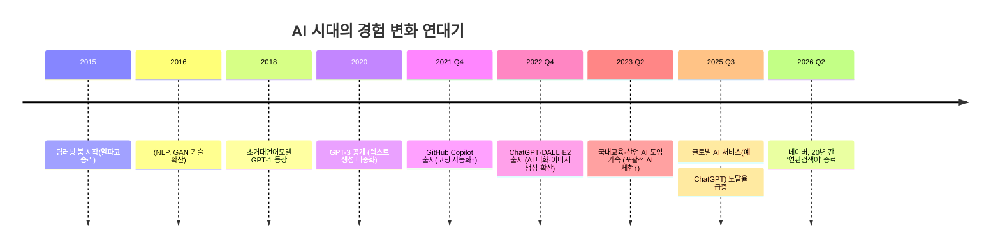

# AI 시대, 사라진 경험과 영향 분석

## Executive Summary  
AI 기술의 비약적 발전(특히 2015년 이후 대규모 언어모델·생성형 AI 등장)은 다양한 인간적 경험을 감소시켰다. 예를 들어, Naver는 20년 운영해온 ‘연관검색어’ 기능을 종료해 AI 기반 추천으로 탐색 학습을 대체했다. AI는 인간 창작자가 겪는 **창의적 난관(creative blocks)** 을 회피하며 결과물을 즉시 제공하므로, 몰입(flow)·시행착오·노력이 줄고 궁극적 창의성도 위축될 우려가 제기된다. 또한 AI 챗봇 의존도가 높아질수록 외로움·사회불안이 늘어나는 연구 결과도 있다. 산업별로는 법률·의료·고객서비스·소프트웨어 등 지식집약 분야에서 AI가 인간 업무를 빠르게 대체 중이며, 특히 청년층(20대 초반) 고용 감소가 관찰된다. 본 보고서에서는 주요 경험 유형별 감소 양상과 근거, 원인, 영향 산업 및 대응 전략(교육·설계·규제·개인 대처)을 종합 분석한다.

## 사라진(감소한) 경험 유형  
- **탐색적 학습 & 우연 발견 감소:** 전통적 검색의 ‘키워드 연관 탐색’ 기능(예: Naver 연관검색어)을 AI가 실시간 맥락 추천으로 대체함에 따라, 우연한 정보 탐색 경험이 줄어들고 있다. WSJ 보도에 따르면 미국 데스크톱 검색의 5.6%가 ChatGPT 같은 AI 툴에 의존하며(1년 전 대비 2배 증가), 필연적 편향과 편식된 정보 노출 가능성이 제기된다.  
- **시행착오 학습 감소:** AI는 문제 해결 과정을 단축시키고 정답을 제시하기에, 학생들과 전문가들은 스스로 해법을 모색하고 반성하는 시행착오 기회를 잃는다. 미 교육기관 비평에 따르면 AI 도구(예: ChatGPT) 활용이 강화되면 학습자들이 복잡한 문제 해결 과정을 “스스로 시도해보고 새로운 방안을 찾고 다시 시도”하는 전통적 학습이 차단되며, 이는 전문성 개발을 저해한다.  
- **창의적 몰입과 고뇌 감소:** AI는 24시간 답을 내놓고 창작의 난관(creative block) 없이 창작물을 생성한다. Kellogg 연구진은 “AI는 빠르게 창조하며 경험적 창작 고통을 겪지 않으므로, 궁극적으로 인간 창작자의 몰입 경험과 창의적 동기를 줄일 수 있다”는 점을 지적했다. 예를 들어 AI로 작곡된 ‘Fake Drake’ 사례는 소비자들에게 즉각적 만족을 줬으나, 인간 음악가의 **창작 과정을 통한 몰입과 성장** 기회를 대체하면서 업계 갈등(작가·음악가 파업)으로 이어졌다.  
- **수작업·기술숙련도 감소:** 전통적 수공예·숙련기술(캘리그래피, 목공, 설계 등)이 자동화·AI화로 대체되면서 손맛(handmade)이나 현장 경험이 줄어든다. 예컨대 사진 편집에서 ‘매직 지우개’ 같은 AI 도구는 정밀한 수작업 대신 버튼 클릭을 권장한다. 이러한 전환은 장기적으로 **기술습득 동기와 숙련도**를 약화시킬 수 있다.  
- **사회적 상호작용 질 저하:** AI 챗봇·대화 에이전트 이용이 늘면서 사람들 간 직접 소통 기회가 줄어든다. MIT 연구팀의 실험에 따르면, AI 챗봇 사용이 잦은 참가자들은 외로움·AI 감정 의존도가 높아지고 실제 대인관계는 감소하는 등 부정적 심리 변화가 관찰됐다. 이는 궁극적으로 **인간관계 형성의 질 저하**로 이어질 수 있다.  
- **책임감·주인의식 감소:** (간접적 영향) 업무나 창작물을 AI에 의존할수록 결과물에 대한 주인의식과 책임감이 약화된다. 예컨대 AI가 결과물을 만들면 “내가 해냈다”는 성취감이 줄어들고, 사고·오류 시 책임소재가 모호해진다. 관련 연구는 드물지만, AI 기반 의사결정 도구 활용 시 **책임 윤리 문제**가 부각된다.  

## 감소 정도와 증거 요약 (경험 유형별)  
아래 표는 각 경험 유형의 감소·감소 양상, 근거 사례, 주요 영향 산업 및 대응 전략을 요약한 것이다. 

| 경험 유형             | 감소 양상 (정량/정성)                  | 근거 사례 및 통계                   | 영향 산업/직무       | 권장 대응                           |
|--------------------|------------------------------------|-------------------------------------|-------------------|-------------------------------------|
| 탐색적 학습·우연발견  | 서서히 감소 (예: 검색추천→AI제안)       | 네이버 ‘연관검색어’ 종료, AI 검색 점유율 5.6% (↑2배) | IT(검색), 미디어      | AI 보조 검색 기능 관리/설계, 학습 시 주제 발굴 지도 |
| 시행착오 학습        | 급격히 감소 (AI즉답→학습기회 상실)       | AI 에세이 도구 비판: “ChatGPT 같은 보조는 학습 개발阻害” | 교육, 연구개발 등    | 학생·직원에게 비판적 사고 훈련, 학습 전 AI사용 금지 검토 |
| 창의적 몰입·고뇌     | 감소 (AI 즉시생성 vs 인간 고뇌)         | AI음악 ‘Fake Drake’ 사례: 소비자즉시만족 vs 창작자 손해 | 예술·콘텐츠, 디자인  | 창작 교육 강화, 크리에이티브 워크숍 등 **과정 존중** 강조 |
| 수작업·기술숙련도    | 장기적 감소 (자동화 확대)             | 교육계 “직접 글쓰기·연습 효과↑” (손글씨 수업 사례)* | 제조업, 수공예, 사진편집 | 현장실습 강화, AI기능 이해 교육, 공예·예술 지원책 |
| 사회적 상호작용     | 감소 (AI친구↑→인간관계↓)               | MIT 연구: 챗봇 과다사용 시 외로움↑, 인간 대인관계↓ | 서비스업, 고객응대    | AI·인간 연계형 상담 설계, 사회적 활동 장려 |
| 책임감·주인의식     | 감소 (AI의존↑→책임경감)               | *구체적 수치 부족*; 조직신뢰 이슈 제기 | 관리자, 창작자 등    | AI결과 검증 규정, 결정권자 명확화, 도덕 교육 |
| 우연발견(Serendipity) | 감소 (맞춤형 제안↑→우연↓)             | Naver “연관검색→AI추천” 전환 | 정보·교육·마케팅     | 사용자 주도 탐색 인터페이스 유지, 랜덤 요소 도입 |

*정부·민간 보고, 학술 자료 등 직접 수치 확보 어려움. 경험 변화는 위 사례·연구를 통해 간접 추론한 결과임을 밝힘.

## 영향 산업·직무·연령·문화권  
AI 대체는 글로벌·한국을 막론하고 광범위하게 진행 중이다. Bill Gates(2026)는 **법률·의료·고객서비스·소프트웨어·제조업** 등 다양한 분야의 일자리가 10년 내 빠르게 영향 받을 것이라 전망했다. 실제로, AI 도구 도입 이후 특히 20대 초반 청년 취업률이 유의미하게 감소하는 모습이 나타났다. 예컨대 고객응대·영업, 프로그래밍 초급·사무직, 법률사무(파라리걸), 금융대출 평가, 데이터 분석, 병원 진료 보조 등 **지식집약 직종**이 우선 타격을 받는 것으로 분석된다. 반면 고급 창의·감성 노동이나 전략적 의사결정 역할은 상대적으로 덜 대체되나, AI가 창작물·디자인 지원에 활용됨에 따라 인간 고유 분야 경계도 모호해지고 있다. 

연령별로는 디지털 기기에 친숙한 **젊은 세대**가 AI 의존도가 높아 학습·취업 기회 변동에 민감하다. 문화권별로는 AI 도입 속도가 빠른 북미·유럽 등과 비교해 한국도 2020년대 중반부터 AI 서비스 확산이 급속히 증가했으며, 교육·행정·검색 등 생활 전반에 AI가 침투 중이다. 한국어 AI(예: Kakao i, Naver HyperCLOVA) 사용자 증가도 정성적으로 보고되고 있다.

## 변화 타임라인  
AI 관련 기술과 경험 변화는 2015년 이후 급격히 진행되었다. 아래 타임라인은 주요 기술·사건과 경험 감소 시점을 대략적으로 정리한 것이다.

위 타임라인에서 볼 수 있듯 2020년대 중반부턴 AI 기반 상호작용이 일상화되며, 사람들의 **직접 경험(playful, hands-on)** 과 **탐색 과정**이 큰 변화를 겪었다.

## 사라진 경험의 대체・보완 활동  
사라진 경험을 완전히 되살리기는 어렵지만, 새로운 경험이나 병행 활동으로 보완 가능하다. 예컨대 **AI 추천의존**을 줄이기 위해 사용자가 직접 키워드 탐색을 하는 ‘비AI 모드’를 도입하거나, **창의 과정 강화**를 위해 AI 결과물을 검토·재창조하는 교육(예: AI가 만든 초안 첨삭하기)을 시행할 수 있다. 사회적 상호작용이 줄어드는 점을 보완하려면, 오프라인 네트워킹과 협업 프로젝트를 활성화할 필요가 있다. 수작업 경험 감소에 대응해, 공예·미술체험 프로그램이나 봉사활동(현장체험)을 확대하여 손맛·연결감을 제공할 수 있다. 또한 AI 도구 사용 시 반드시 **출처 검증**과 **책임 소재 명시**를 교육·제도화함으로써 주인의식을 유지하도록 유도해야 한다.

## 윤리·사회·정책적 함의  
AI로 인해 경험이 단절되면 개인의 **정체감과 사회자본**에도 영향을 미칠 수 있다. 학습 경험 감소는 교육 불평등을 심화시킬 수 있고, 작업 몰입도 저하는 직무 만족도와 정신건강 악화로 이어질 우려가 있다. AI 친화적 환경에서 성장한 세대는 비판적 사고능력이 약화될 수 있으며, 지나친 AI 의존은 사회적 고립과 외로움 증가라는 부작용을 낳을 수 있다. 정책적으로는 **AI 윤리 가이드라인**을 통한 책임소재 명확화, 교육과정에 AI 활용과 인간 역량 개발의 균형 교육 등을 강화해야 한다. 예를 들어 EU의 AI 법안(일부 가상인간 규제)이나 한국의 개인정보·저작권 법 개정 논의처럼, AI 사용의 투명성과 개인 권리를 보호하는 법적 기반을 마련할 필요가 있다.

## 대응 전략 및 권고  
1. **교육과 역량 강화:** 교·강사와 기업은 AI 활용 능력뿐 아니라 AI 없는 상황에서의 *문제해결 경험, 비판적 사고, 창의성 발휘* 훈련을 병행해야 한다. (예: 코딩 수업에서 AI 없이도 구현해보게 함, 에세이 작성 후 AI 비교 분석 교육 등).  
2. **디자인·기술적 조치:** 서비스·제품 설계 시, 사용자가 자발적 참여와 탐색을 경험할 수 있는 인터페이스를 유지해야 한다. 예컨대 AI 추천 시스템에 랜덤 요소를 추가하거나, UI상 ‘전통적 보기’ 옵션을 제공하여 우연 발견을 지원할 수 있다. 검색 서비스는 AI 추천 대신 정규 검색 경험을 선택할 수 있게 하는 것이 하나의 방안이다.  
3. **개인적 대처:** 개인 차원에서도 AI 사용 습관을 점검하고 의도적 휴지(예: 하루 일정 시간 AI 없이 검색·학습하기)를 가지는 것이 바람직하다. 또한 AI 제작물 사용 시 출처를 인지하고, 자신의 노력으로 문제를 해결해보는 연습을 통해 주인의식을 지켜야 한다.  
4. **사회·정책적 대응:** 정부와 교육기관은 AI 시대의 심리·윤리 교육을 강화하고, 전통적 경험을 되살리는 사회적 프로그램(예: 지역문화예술 참여 확대) 지원을 고려해야 한다. 노·장년층도 AI 서비스를 활용할 기회를 제공하면서, 이들에게는 인간적 상호작용이 풍부한 커뮤니티 활동을 병행할 수 있게 유도해야 한다.

以上와 같이, AI 도입으로 감소하는 다양한 경험은 단순한 기술 변화가 아니라 학습·창의·사회구조 전반에 걸친 변화임을 인식해야 한다. 해당 변화의 **정량·정성적 증거**를 면밀히 모니터링하고, 교육·디자인·정책 측면에서 적극적으로 대응함으로써 인간다움을 보존하고 새로운 기회를 창출해야 할 것이다.

