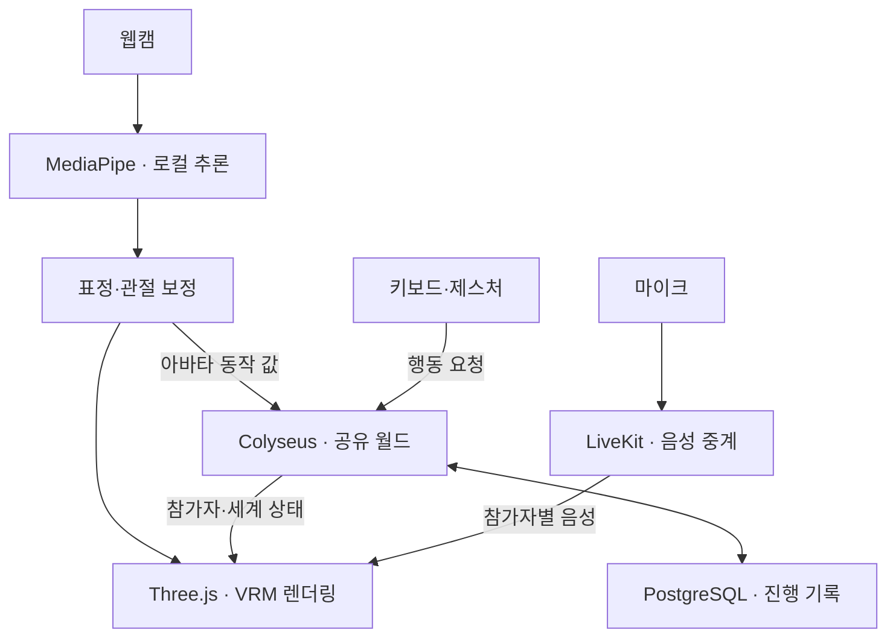

# 노트북 웹캠 기반 메타버스 기술 스택 검토

- **검토 기준일:** 2026년 11월 6일
- **대상 환경:** 맥북 및 일반 노트북의 내장 웹캠
- **기본 배포 가정:** 설치 없이 접속하는 브라우저 서비스
- **사용 상황:** 한 기기에서 한 사람이 책상 앞에 앉아 사용하는 환경
- **문서 성격:** 공식 문서와 저장소를 바탕으로 한 기술 검토 및 설계 제안
- **검증 상태:** 실제 구현·기기별 벤치마크는 수행하지 않음. 아래 성능 수치는 초기 목표값이며 보장값이 아님.

## 1. 권장 방향

맥북·일반 노트북의 내장 웹캠으로 사용자의 표정과 움직임을 아바타에 반영하는 메타버스를 구현할 수 있다. 첫 버전은 **얼굴·고개 추적을 기본으로 하고, 손 제스처를 선택적으로 추가하는 브라우저 서비스**를 권장한다.

### 권장 기술 조합

| 영역 | 권장 조합 |
| --- | --- |
| 클라이언트 | TypeScript + React + Three.js / React Three Fiber |
| 웹캠 추적 | MediaPipe Tasks Vision |
| 아바타 | VRM 1.0 + @pixiv/three-vrm |
| 실시간 월드 | Node.js + Colyseus |
| 음성 | LiveKit / WebRTC |
| 영속 저장·계정 | PostgreSQL + Supabase Auth / Storage |
| 그래픽 기준 | WebGL2 기본, WebGPU는 기기별 검증 후 적용 |

이 문서는 **웹캠 속 사용자의 얼굴·상체 움직임을 가상공간의 아바타에 반영하고, 다른 사람과 같은 공간에서 활동하는 서비스**를 전제로 한다. 웹캠으로 실제 방을 스캔해 3D 공간으로 복원하는 구상은 별도의 공간 인식·복원 요구사항과 기술 스택을 검토해야 한다.

## 2. 웹캠 입력으로 구현할 범위

노트북 앞에 앉아서 사용하는 조건에서는 카메라 시야와 가림을 제품 설계에 반영해야 한다.

| 기능 | 첫 버전 판단 | 구현 방향 |
| --- | --- | --- |
| 고개 돌리기·끄덕이기 | 기본 기능 | 머리 회전을 아바타의 목·머리에 반영 |
| 눈 깜빡임·입 움직임·표정 | 기본 기능 | 얼굴 추적 결과를 아바타 표정에 연결 |
| 손 흔들기·손바닥 펼치기 등 | 선택 기능 | 손이 화면에 들어왔을 때 인식 |
| 어깨·상체·팔 움직임 | 조건부 적용 | 보이는 관절만 반영하고, 가려지면 기본 자세로 복귀 |
| 하체·걷기·전신 모션캡처 | 촬영 조건을 별도로 확보 | 전신이 카메라에 들어오는 배치 필요 |
| 가상공간 이동 | 키보드·마우스를 기본 입력으로 권장 | 웹캠은 표정과 제스처 표현에 활용 |
| 실제 방의 위치·크기·깊이 측정 | 별도 기술 범위 | 공간 복원·추적 요구사항부터 정의 |

MediaPipe의 공식 출력은 다음과 같다.

- **Face Landmarker:** 얼굴당 478개 3D 랜드마크, 선택적 52개 표정 계수, 선택적 4×4 얼굴 변환 행렬. 단일 얼굴 설정에서 시간축 smoothing을 적용한다. [S01]
- **Hand Landmarker:** 손당 21개 3D 랜드마크와 좌우 손 구분, 영상 좌표 및 world 좌표를 제공한다. [S02]
- **Pose Landmarker:** 33개 신체 랜드마크와 영상·world 좌표, visibility·presence 정보를 제공한다. [S03]

신체의 3D 좌표는 영상에서 **추정한 값**이다. Pose의 world 좌표는 골반 중심을 원점으로 하므로, 이를 그대로 실제 방 안의 절대 위치나 정확한 거리 측정값으로 사용해서는 안 된다. [S03]

### 세계 경험에 대한 제안

이 입력 조건에는 대화·탐험·협업·역할극 중심의 세계가 잘 맞는다. 예를 들어 우주선 승무원 공간, 마법학교의 교실, 가상 작업실처럼 얼굴과 목소리, 가끔의 손동작이 의미 있는 환경부터 설계할 수 있다.

카메라에 잡히지 않는 하체는 기본 애니메이션으로 표현하고, 이동은 키보드·마우스로 처리하는 구성을 첫 범위로 권장한다.

## 3. 상세 기술 스택

| 영역 | 추천 기술 | 역할과 선택 이유 |
| --- | --- | --- |
| 웹 애플리케이션 | TypeScript + Vite + React | 입장 화면, 계정, 채팅, 설정, 인벤토리와 3D 화면 연결 |
| 3D 렌더링 | Three.js + React Three Fiber | 월드·캐릭터·카메라 렌더링. React UI와 같은 프로젝트에서 관리 |
| 웹캠 추적 | @mediapipe/tasks-vision | Face Landmarker를 기본으로 하고 Hand / Pose를 단계적으로 추가 |
| 추론 실행 | Web Worker + WASM, 필요 시 GPU delegate | 영상 분석으로 화면과 입력 처리가 멈추지 않도록 작업 분리 |
| 아바타 | VRM 1.0 + @pixiv/three-vrm | 휴머노이드 뼈대, 표정, 시선 등 아바타 제어 |
| 공간·자산 제작 | Blender → GLB / glTF, 캐릭터는 VRM | 배경과 아바타의 제작·배포 경로 정리 |
| 충돌·물리 | Rapier / @react-three/rapier, 필요 시 추가 | 바닥·벽 충돌, 이동 가능한 물체 등 |
| 실시간 월드 | Node.js + Colyseus | 방 생성, 입장, 위치·오브젝트·상호작용 상태 동기화 |
| 음성 | LiveKit / WebRTC | 참가자별 음성 전달, 거리 기반 음량 처리 |
| 계정·영속 저장 | Supabase Auth + PostgreSQL + Storage | 계정, 아바타 파일, 세계 설정, 퀘스트·아이템·진행 기록 |
| 배포 | 정적 웹 / CDN + 지속 실행되는 Node 서버 | 클라이언트와 실시간 서버를 각각 배포·확장 |

위 표는 제품 요구사항을 바탕으로 한 **선택 제안**이다. 주요 제품의 공식 역할은 다음과 같다.

- Colyseus는 서버가 방 상태를 변경하고, 클라이언트에 속성별 변경분을 전달하는 구조다. [S04]
- LiveKit은 참가자의 음성·영상 트랙을 중계하는 WebRTC SFU다. [S05]
- Supabase는 PostgreSQL을 기반으로 Auth·Storage 등을 통합한다. [S06]

각각 **세계 상태, 음성, 영속 데이터**를 맡기면 책임을 명확하게 나눌 수 있다.

### 3.1. 버전 조합

검토 시점의 R3F 공식 문서는 React 19와 React Three Fiber 9 조합을 명시한다. R3F 10은 alpha로 안내한다. 물리를 추가할 경우 @react-three/rapier 2가 React 19 / R3F 9를 지원한다. [S07] [S08]

| 구성요소 | 초기 선택 기준 |
| --- | --- |
| React | 19 계열 |
| React Three Fiber | 9 계열 |
| @react-three/rapier | 필요 시 2 계열 |
| Three.js / three-vrm | 선택한 조합의 호환성을 실제 실행으로 확인한 뒤 고정 |
| MediaPipe 패키지·WASM·모델 | 함께 검증한 버전과 자산 경로를 고정 |

이 조합은 설치·실행을 완료한 패키지 잠금 파일을 의미하지 않는다. 프로젝트를 시작할 때 의존성 호환성을 확인하고 실제 사용 버전을 고정해야 한다.

## 4. 시스템 구조와 데이터 흐름

웹캠 영상 분석은 사용자 기기에서 수행하고, 다른 참가자에게는 아바타를 움직이는 데 필요한 값만 보내는 구조를 권장한다.

### 4.1. 표정과 몸짓: 최신 상태 중심

고개 회전, 입 벌림, 눈 깜빡임 같은 값은 제한된 주기로 보내고, 수신 측에서 부드럽게 보간한다.

첫 버전에서는 Colyseus로 함께 전달해 구조를 단순하게 유지할 수 있다. 이후 동작 지연이 문제가 되면 LiveKit의 lossy 데이터 전송으로 분리하는 방안을 검토한다. 이 경우 순서 번호와 시간을 넣어 오래된 상태를 버리는 처리가 필요하다. LiveKit의 lossy 패킷은 순서를 보장하지 않는다. [S09]

얼굴의 모든 원본 랜드마크를 항상 전달하기보다, 실제 아바타 표현에 쓰는 회전과 표정 계수를 전송하는 방식을 권장한다.

### 4.2. 게임 행동: 서버 판정

이동, 문 열기, 아이템 획득, 퀘스트 완료는 클라이언트의 요청을 받은 뒤 서버에서 가능 여부를 확인한다.

예를 들어 손 제스처로 마법을 쓰는 기획에서는 다음 순서로 처리한다.

1. 클라이언트가 웹캠에서 손 제스처를 인식한다.
2. 인식 결과를 ‘마법 사용 요청’으로 변환한다.
3. 서버가 거리·재사용 대기시간·자원·대상 등을 확인한다.
4. 서버가 결과 상태를 변경하고 참가자에게 동기화한다.

Colyseus의 상태 동기화 위에 이러한 규칙을 직접 구현해야 한다. 프레임워크 사용만으로 행동 검증이 완성되는 것은 아니다. [S04]

### 4.3. 영속 데이터: 진행과 사건 저장

계정, 소유 아이템, 관계, 진행도, 중요한 사건처럼 오래 남겨야 하는 결과를 PostgreSQL에 저장한다. 매 프레임의 고개 각도와 손가락 좌표는 실시간 전송용 데이터로 관리한다.

### 4.4. 음성: 위치와 연결

참가자 위치에 따라 개별 음성 트랙의 음량을 조절하면 거리감을 만들 수 있다. LiveKit 공식 문서도 참가자 간 거리에 따른 오디오 트랙 음량 조절을 사용 사례로 제시한다. [S10]

거리 기반 음량 처리부터 시작하고, 방향감까지 필요한 경우 공간 음향 처리를 추가하는 것을 권장한다.

## 5. 추적 결과를 자연스러운 아바타로 바꾸는 작업

### 5.1. 표정과 뼈대의 매핑

MediaPipe에서 52개 표정 계수가 나온다고 모든 VRM 캐릭터가 그대로 재현하는 것은 아니다. VRM 1.0의 기본 표정은 선택 사항이며 사용자 정의 표정도 허용한다. **추적기 출력과 아바타가 실제로 가진 표정을 연결하는 매핑 계층**이 필요하다. [S11]

첫 아바타는 다음 표현을 확실히 지원하도록 제작하거나 선택한다.

- 좌우 눈 깜빡임
- 입 열림
- 웃음 등 핵심 표정 몇 가지
- 고개와 목의 회전
- 추적이 끊겼을 때 돌아갈 기본 자세

세밀한 얼굴 표현이 필요하면 대응하는 morph target을 아바타 자산에 준비해야 한다. 이는 라이브러리 선택과 함께 계획해야 할 자산 제작 범위다.

### 5.2. 중립 자세 보정과 추적 실패 처리

권장 처리 흐름은 다음과 같다.

1. 초기 정면 자세를 기준으로 고개와 표정의 중립값을 잡는다.
2. 작은 떨림은 smoothing과 dead zone으로 완화한다.
3. 회전과 표정 값을 시간에 따라 부드럽게 보간한다.
4. 얼굴이나 손이 사라지면 일정 시간 동안 기본 자세로 복귀한다.
5. 추적이 재개되면 갑자기 튀지 않도록 다시 연결한다.

낮은 신뢰도의 관절을 무리하게 움직이는 것보다, 해당 부위의 기본 애니메이션으로 자연스럽게 복귀하는 정책을 권장한다.

### 5.3. 좌우 반전과 좌표계

공식 문서는 수평 반전된 영상을 입력하면 얼굴·손의 좌우 의미가 뒤집힌다고 설명한다. 미리보기의 거울 효과와 실제 추론 입력의 좌표계를 구분하고, 추론부터 아바타 적용까지 일관되게 처리해야 한다. [S01] [S02]

### 5.4. 추론과 렌더링의 실행 주기 분리

MediaPipe의 동기 추론은 호출한 스레드를 점유한다. 공식 가이드는 웹에서 Worker 사용을 안내하고, 얼굴 추적 Worker 예제도 제공한다. [S12] [S13]

권장 구현 원칙은 다음과 같다.

- 화면 렌더링과 별도로 추론을 실행한다.
- 이전 추론이 끝나지 않았으면 오래된 프레임을 쌓지 않고 최신 프레임을 우선한다.
- 얼굴·손·신체 추론을 모두 렌더링 FPS에 맞추려 하지 않는다.
- GPU 추론을 사용할 때는 3D 렌더링과 함께 실행한 성능을 측정한다.
- 추론 주기와 아바타 상태 전송 주기를 따로 조절한다.

React에서도 매 프레임 추적값을 setState()로 갱신하기보다, R3F 공식 가이드처럼 useFrame과 객체 참조를 통해 빠르게 변하는 위치·회전·표정을 갱신하는 편이 적합하다. React 상태는 UI에 필요한 값 위주로 관리한다. [S14]

## 6. 맥북·브라우저 호환성과 의존성 확인

### 6.1. WebGL2를 첫 기준으로 선택

현재 Three.js의 WebGLRenderer는 WebGL2를 사용한다. WebGL1 지원은 r163부터 종료됐다. 지원 조건도 단순한 ‘WebGL 가능’이 아니라 **WebGL2 사용 가능 여부**로 확인해야 한다. [S15]

### 6.2. Safari의 WebGPU 지원과 도입 조건

GPUWeb 공식 구현 현황은 **macOS Tahoe 26에서 WebGPU가 기본 활성화**된다고 안내한다. Safari가 WebGPU를 지원하지 않는다는 과거 설명을 그대로 적용하면 안 된다. 반대로, 구형 OS·기기까지 포함한 전체 대상 환경의 호환성을 보장하는 근거로도 사용할 수 없다. [S16]

three-vrm은 v3부터 WebGPU 렌더러 연동을 지원한다. MToon 재질은 MToonNodeMaterial 설정이 필요하고, 해당 재질은 Three.js r167 이상을 요구하며 버전 호환성 주의사항도 명시한다. [S17]

권장 도입 순서는 다음과 같다.

1. WebGL2로 첫 기능과 성능을 검증한다.
2. 동일 장면·동일 추적 조건에서 WebGPU와 비교한다.
3. 아바타 재질과 후처리 호환성을 확인한다.
4. 지원 기기에서 이점이 확인되면 WebGPU 사용 범위를 정한다.

렌더러의 WebGPU 도입과 추론 런타임의 GPU 가속은 각각 검토해야 한다.

### 6.3. KalidoKit의 유지보수 상태

원본 KalidoKit 저장소는 검토 시점에 공식 deprecated 상태를 명시한다. 기존 MediaPipe + KalidoKit 예제를 참고할 수는 있지만, 신규 프로젝트의 핵심 의존성으로 선택하는 것은 권장하지 않는다. MediaPipe의 표정·변환 출력을 활용하고 아바타에 맞는 보정·매핑 코드를 관리하는 방향이 적합하다. [S18]

### 6.4. 카메라 권한과 입장 흐름

getUserMedia()는 HTTPS 같은 보안 컨텍스트와 사용자 권한이 필요하다. 장치 사용 불가, 권한 거부 등 실패 상황도 처리해야 한다. [S19]

카메라 사용이 불가능해도 음성·키보드와 기본 아바타로 입장할 수 있는 흐름을 권장한다.

### 6.5. 영상 처리와 SDK 데이터 전송의 구분

MediaPipe 공식 고지는 입력 이미지·영상 등을 기기에서 처리하고 Google 서버로 보내지 않는다고 설명한다. 동시에 API 성능·사용 관련 metrics 전송도 명시한다. [S20]

따라서 제품 안내에서는 다음을 구분해야 한다.

- 웹캠 원본을 서비스 서버에 업로드하지 않도록 설계할 수 있다.
- 참가자에게 아바타 상태와 음성을 전달하는 네트워크 통신은 존재한다.
- 사용하는 SDK의 별도 데이터 전송 항목은 해당 버전의 공식 고지를 확인한다.

## 7. 초기 성능 목표와 검증 계획

아래 수치는 **설계·검증을 시작하기 위한 제안값**이다. 특정 맥북에서 실측했거나 보장된 성능이 아니다.

| 항목 | 초기 목표 |
| --- | --- |
| 카메라 입력 | 640×480 또는 720p, 30fps 요청 |
| 얼굴 추론 | 초당 20~30회 |
| 손·상체 추론 | 초당 10~15회부터 시작, 필요 시 활성화 |
| 3D 렌더링 | 기본 30fps, 여유 있는 기기는 60fps |
| 아바타 상태 전송 | 초당 10~20회, 수신 측에서 보간 |
| 첫 멀티플레이 시험 | 방당 8~16명 |
| 그래픽 시작점 | 작은 공간, 단순한 조명, 제한된 재질·텍스처 |

### 7.1. 실제 기기 검증

**웹캠 추적 + 월드 렌더링 + 여러 아바타 + 음성 통화**를 동시에 켠 상태에서 검증한다. 얼굴 추적 단독 데모의 FPS만으로 전체 서비스를 판단하지 않는다.

권장 최소 시험군은 다음과 같다.

| 시험군 | 확인 환경 |
| --- | --- |
| Apple Silicon MacBook Air | Safari와 Chrome 각각 확인 |
| Windows 내장 그래픽 노트북 | Chrome 또는 Edge에서 확인 |
| Intel Mac | 지원 대상에 포함할 경우 별도 시험군으로 추가 |

주요 관찰 항목은 평균 FPS, 순간적인 끊김, 추적 복귀, 메모리 증가, 장시간 사용 후 성능 저하다.

### 7.2. 부하를 줄이는 순서

1. 렌더링 해상도와 Retina 화면의 DPR 상한을 조정한다.
2. 손·상체 추론 빈도를 줄인다.
3. 멀리 있는 아바타의 표정·머리카락 물리 갱신 빈도를 줄인다.
4. 조명·그림자·후처리와 자산 복잡도를 조정한다.

### 7.3. 동시 접속과 방당 인원

전체 동시 접속자 수와 한 방에서 동시에 보이는 아바타 수는 따로 정해야 한다.

Colyseus는 프로세스를 늘려 방 수를 확장하지만, 개별 방은 하나의 프로세스에 속한다. Redis는 여러 프로세스의 공유 Presence·Driver에 사용된다. [S21]

따라서 Redis 도입만으로 단일 방의 처리 인원이 무제한 늘어나는 것은 아니다. 방당 대규모 인원을 목표로 한다면 구역 분할과 가까운 참가자만 동기화하는 설계를 추가해야 한다.

## 8. 세계관을 데이터와 규칙으로 구현하는 방법

세계관이 지속되는 제품에는 공간 자산과 함께 다음 세 계층을 두는 것을 권장한다.

| 계층 | 담을 내용 | 예시 |
| --- | --- | --- |
| 세계 설정 | 지역, 역사, 세력, 규칙, NPC의 기본 정보 | 이 도시는 세 진영이 관리하고, 밤에는 특정 문이 닫힌다 |
| 현재 상태 | 플레이어 관계, 퀘스트, 물체 상태, 소유권 | 플레이어가 열쇠를 얻었고 특정 NPC의 신뢰도가 올랐다 |
| 사건 기록 | 누가 언제 무엇을 바꿨는지 | 탐험대가 발전기를 복구해 새 구역이 열렸다 |

### 8.1. 상호작용 예시

‘손을 들어 문양을 만들면 문이 열리는 마법학교’를 예로 들면 다음과 같이 연결한다.

1. 웹캠이 손동작을 인식한다.
2. 클라이언트가 서버에 주문 사용을 요청한다.
3. 서버가 해당 주문의 사용 조건을 확인한다.
4. 서버가 문 상태를 변경하고 참가자에게 전달한다.
5. DB가 문이 열린 결과와 퀘스트 진행을 남긴다.

입력·규칙·기록을 연결하면 세계의 변화가 다른 참가자에게도 일관되게 보인다.

### 8.2. AI NPC의 추가 범위

AI NPC를 도입할 경우 다음 구조를 권장한다.

- 서버에서 세계관·플레이어 진행·NPC가 아는 사실을 조회한다.
- 조회한 정보를 바탕으로 대사를 생성한다.
- 아이템 지급·퀘스트 완료·세계 변경은 검증된 서버 행동 API를 거친다.
- 중요한 결과와 진행 상태는 DB에 저장한다.

초기에는 정해진 대화와 퀘스트 상태 전이로 세계의 기본 규칙을 검증하고, 이후 생성형 대화를 추가할 수 있다. 본 검토에서는 특정 LLM 제공자·요금제·음성 AI 모델을 확정하지 않는다.

## 9. 대안 엔진 선택 기준

| 선택지 | 적합한 상황 | 이번 검토의 판단 |
| --- | --- | --- |
| Three.js + React Three Fiber | 웹 UI, 브라우저 카메라, JavaScript 추적 SDK, 음성을 함께 연결하는 서비스 | 우선 추천 |
| Babylon.js | 팀이 게임 엔진 중심의 웹 개발 흐름을 선호하는 경우 | 유효한 대안 |
| Unity | 기존 Unity 인력·자산이 있거나 네이티브 게임 앱까지 확장하는 경우 | 웹 SDK 연결과 배포 제약을 포함해 검토 |

Babylon.js는 공식적으로 WebGL과 WebGPU를 모두 지원한다. [S22]

Unity를 웹으로 배포하는 경우 브라우저 SDK 연결 작업을 고려해야 한다. Unity 6.3 웹 문서는 C# managed threading과 네트워킹 제약을 명시한다. 네이티브 플랫폼과 동일한 실행 조건을 가정해서는 안 된다. [S23]

엔진 간 성능 우열은 본 문서에서 실측하지 않았다. 팀의 기존 역량, 배포 방식, 자산 제작 흐름과 목표 장면을 기준으로 선택해야 한다.

## 10. 첫 개발 범위와 완료 기준

| 단계 | 구현 범위 | 확인할 결과 |
| --- | --- | --- |
| 1. 로컬 아바타 검증 | 고개·눈 깜빡임·입 움직임을 VRM 한 종에 연결 | 중립 보정, 자연스러운 움직임, 추적 실패·복귀 처리 |
| 2. 공유 공간 검증 | 작은 방에서 두 사람이 서로의 아바타를 보고 음성 대화 | 동작 동기화와 음성이 동시에 동작하는지 확인 |
| 3. 세계 규칙 검증 | 문 열기·물건 획득·퀘스트 한 개 | 서버 판정, 상태 동기화, 진행 저장 |
| 4. 대상 기기 검증 | 방당 8~16명 시험, 손 제스처 추가, 품질 조절 | 대상 노트북의 실제 성능과 적정 기능 범위 확인 |

**첫 번째 기술 검증의 완료 기준은 작은 3D 공간에서 두 사람이 웹캠 아바타와 음성을 동시에 사용하고, 추적이 끊겼다가도 자연스럽게 복귀하는 것이다.**

이 결과를 바탕으로 대상 노트북에서 가능한 그래픽 수준과 추적 범위를 정하고, 세계의 규모와 콘텐츠 제작량을 결정한다.

### 설계 확정 전에 정할 항목

- 브라우저 서비스와 네이티브 앱 중 우선 배포 방식
- 최소 지원 노트북·운영체제·브라우저
- 방당 참가자 수와 전체 동시 접속 규모
- 얼굴·손·상체·전신 중 필수 추적 범위
- 아바타 표현 수준과 자산 제작 방식
- 세계의 핵심 상호작용과 AI NPC 필요 여부

## 11. 공식 출처

모든 링크는 앞선 기술 검토에서 확인한 공식 문서·공식 저장소다. 링크의 내용과 버전은 이후 변경될 수 있다. 구현 착수 시 선택한 버전의 문서를 다시 확인한다.

1. [S01 — MediaPipe Face Landmarker][S01]: 얼굴 랜드마크, 표정 계수, 변환 행렬, smoothing, 좌우 반전.
2. [S02 — MediaPipe Hand Landmarker][S02]: 손 랜드마크와 좌우 손 구분.
3. [S03 — MediaPipe Pose Landmarker][S03]: 신체 좌표, visibility·presence, 좌표 추정과 원점.
4. [S04 — Colyseus State Synchronization][S04]: 서버 상태 변경과 차분 동기화.
5. [S05 — LiveKit SFU][S05]: WebRTC 미디어 중계 구조.
6. [S06 — Supabase Database][S06]: PostgreSQL과 Auth·Storage 통합.
7. [S07 — React Three Fiber Introduction][S07]: React / R3F 버전 조합과 alpha 안내.
8. [S08 — React Three Rapier][S08]: React 19 / R3F 9 지원과 물리 통합.
9. [S09 — LiveKit Data Packets][S09]: reliable / lossy 전송의 동작.
10. [S10 — LiveKit Audio Rendering][S10]: 참가자별 음량과 거리 기반 오디오 처리.
11. [S11 — VRM 1.0 Expressions Specification][S11]: 선택적 기본 표정과 사용자 정의 표정.
12. [S12 — MediaPipe Tasks Guide][S12]: 동기 추론과 Worker 사용 지침.
13. [S13 — MediaPipe Face Landmarker Worker Sample][S13]: 공식 Worker 구현 예제.
14. [S14 — React Three Fiber Performance Pitfalls][S14]: 프레임 루프와 빠른 상태 갱신 방식.
15. [S15 — Three.js WebGLRenderer][S15]: WebGL2 사용과 WebGL1 지원 종료.
16. [S16 — GPUWeb Implementation Status][S16]: 브라우저·운영체제별 WebGPU 지원.
17. [S17 — pixiv/three-vrm][S17]: WebGPU 연동과 MToonNodeMaterial 조건.
18. [S18 — KalidoKit Repository][S18]: 원본 프로젝트의 deprecated 고지.
19. [S19 — MDN getUserMedia()][S19]: 보안 컨텍스트, 권한, 오류 조건.
20. [S20 — MediaPipe Tasks Vision README][S20]: 기기 내 입력 처리와 metrics 관련 고지.
21. [S21 — Colyseus Scalability][S21]: 방·프로세스 구조와 Redis 기반 확장.
22. [S22 — Babylon.js WebGPU Support][S22]: WebGL / WebGPU 지원.
23. [S23 — Unity 6.3 Web Technical Limitations][S23]: 웹 스레드·네트워킹 제약.

[S01]: https://developers.google.com/edge/mediapipe/solutions/vision/face_landmarker?tab=Web
[S02]: https://developers.google.com/edge/mediapipe/solutions/vision/hand_landmarker?tab=Web
[S03]: https://developers.google.com/edge/mediapipe/solutions/vision/pose_landmarker?tab=Web
[S04]: https://docs.colyseus.io/state
[S05]: https://docs.livekit.io/reference/internals/livekit-sfu/
[S06]: https://supabase.com/docs/guides/database/overview
[S07]: https://r3f.docs.pmnd.rs/getting-started/introduction
[S08]: https://pmndrs.github.io/react-three-rapier/
[S09]: https://docs.livekit.io/transport/data/packets/
[S10]: https://docs.livekit.io/reference/components/react/concepts/rendering-audio/
[S11]: https://github.com/vrm-c/vrm-specification/blob/master/specification/VRMC_vrm-1.0/expressions.md
[S12]: https://developers.google.com/edge/mediapipe/solutions/tasks
[S13]: https://github.com/google-ai-edge/mediapipe-samples-web/blob/main/src/workers/face-landmarker.worker.ts
[S14]: https://r3f.docs.pmnd.rs/advanced/pitfalls
[S15]: https://threejs.org/docs/pages/WebGLRenderer.html
[S16]: https://github.com/gpuweb/gpuweb/wiki/Implementation-Status
[S17]: https://github.com/pixiv/three-vrm
[S18]: https://github.com/yeemachine/kalidokit
[S19]: https://developer.mozilla.org/en-US/docs/Web/API/MediaDevices/getUserMedia
[S20]: https://github.com/google-ai-edge/mediapipe/blob/master/mediapipe/tasks/web/vision/README.md
[S21]: https://docs.colyseus.io/scalability
[S22]: https://doc.babylonjs.com/setup/support/webGPU/
[S23]: https://docs.unity.com/en-us/engine/6000.3/manual/platform-specific/webgl/intro/technical-overview
